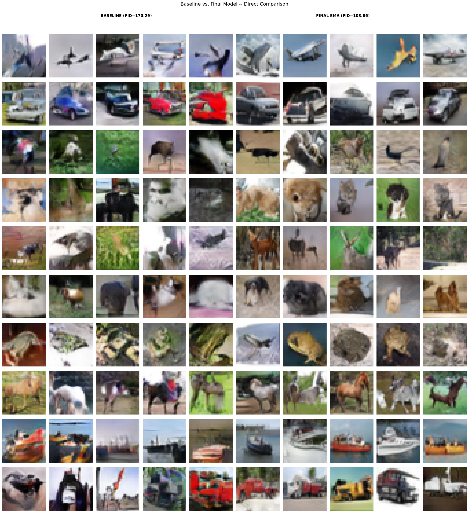
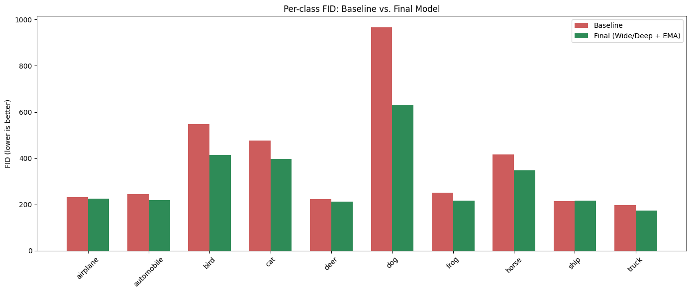
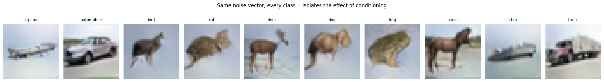
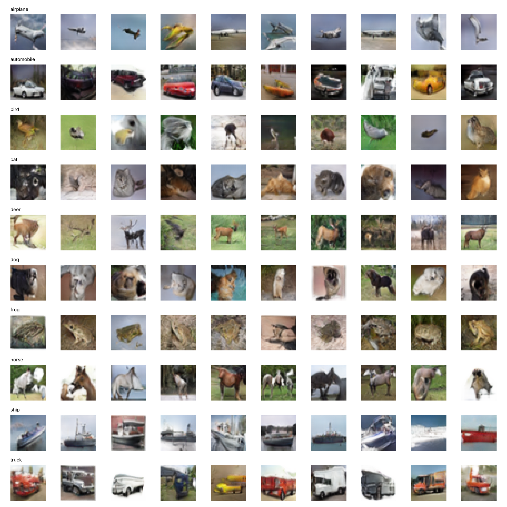

# Conditional GAN for Class-Controlled Image Generation (CIFAR-10)

An individual deep learning project. I trained a conditional DCGAN that generates 32x32 colour images of a requested CIFAR-10 class, then improved it through controlled experiments, changing one thing at a time and evaluating every model with the same eight metrics.

## Headline result

| Metric | Baseline cDCGAN | Final model (wider/deeper + EMA) |
|---|---|---|
| FID (lower is better) | 170.29 | **103.86** (39% lower) |
| KID (lower is better) | 0.0893 | **0.0024** |
| Class-conditioning accuracy | 64.4% | **80.1%** |
| Recall (diversity) | 0.389 | **0.482** |
| Precision | 0.683 | 0.661 |
| Density | 1.378 | 1.051 |
| Coverage | 0.953 | 0.956 |
| Inception Score (classifier-based) | 4.74 ± 0.34 | 5.83 ± 0.35 |

The EMA improvement was reproduced in 5 of 5 independent training sessions. Random chance for class-conditioning accuracy is 10%.



*Each row is one class. Left: baseline. Right: final model.*

## Approach

**Baseline.** The generator maps noise plus a learned 50-dimensional class embedding up through 4x4, 8x8, 16x16 and 32x32 feature maps to an RGB image. The discriminator receives the image and the class label and outputs one real/fake logit, so it judges whether an image is realistic *for its claimed class*. Loss is binary cross-entropy with one-sided label smoothing (0.9). Optimiser is Adam (learning rate 2e-4, beta1 0.5).

**Evaluation.** Every model was scored on the same eight metrics, because no single metric tells the whole story:
- FID and KID: closeness to the real image distribution
- Precision and density: quality of generated images
- Recall and coverage: diversity of generated images
- Class-conditioning accuracy: whether the label really steers generation (scored with an auxiliary classifier)
- Per-class FID: which classes are hard

**Exploratory data analysis.** Before building anything I analysed pixel statistics, class-average images and feature-space (PCA) similarity between classes to anticipate which classes would be difficult and to guide design choices.

## Experiments

Each change was tested on its own against the baseline.

| Experiment | FID | Recall | Class acc. | Outcome |
|---|---|---|---|---|
| Baseline cDCGAN | 170.29 | 0.389 | 64.4% | Reference |
| TTUR (asymmetric learning rates) | 198.09 | 0.337 | 60.0% | Rejected: worse, despite more balanced-looking loss curves |
| Batch size 64, 100 epochs | 161.07 | 0.392 | 63.7% | Small gain; kept |
| UpSampling2D + Conv2D | 137.34 | 0.410 | 64.2% | Better fidelity |
| Self-attention | 163.62 | 0.410 | 58.7% | Rejected: weaker conditioning |
| Wider/deeper networks | 147.14 | 0.406 | 72.0% | Better class conditioning |
| Wider/deeper + UpSampling2D | 160.58 | 0.405 | 64.4% | Gains did not combine |
| **Wider/deeper + EMA from epoch 1** | **103.86** | **0.482** | **80.1%** | **Selected** |

Also tried and rejected: a conditional WGAN-GP (the critic diverged and images relapsed to noise, even after a stabilisation attempt) and a projection discriminator (did not beat the EMA model).

**What the experiments showed**
- Loss curves alone are an unreliable guide. TTUR produced more balanced curves but worse metrics.
- Individually helpful changes did not stack. Combining UpSampling2D with the wider/deeper model scored worse than either alone.
- Capacity (wider/deeper) and weight smoothing (EMA) helped consistently. More specialised changes did not transfer to this dataset and training budget.

**The final model.** Filter widths were doubled at every resolution stage (64, 128, 256 instead of 32, 64, 128) with an extra convolution per stage, trained for 150 epochs. An exponential moving average of the generator weights (decay 0.999, updated every batch from epoch 1) is used at generation time. Wider/deeper supplies capacity and EMA supplies stability.

## Per-class results

The hardest classes improved the most.

| Class | Baseline FID | Final FID | Change |
|---|---|---|---|
| dog | 966.65 | 630.51 | 34.8% lower |
| bird | 548.08 | 414.93 | 24.3% lower |
| cat | 476.75 | 398.12 | 16.5% lower |
| horse | 416.03 | 347.60 | 16.4% lower |
| frog | 251.44 | 216.24 | 14.0% lower |
| truck | 196.89 | 173.95 | 11.6% lower |
| automobile | 245.44 | 217.95 | 11.2% lower |
| deer | 222.50 | 212.10 | 4.7% lower |
| airplane | 230.80 | 224.41 | 2.8% lower |
| ship | 214.10 | 217.00 | 1.4% higher |



## Does conditioning work, and is the model diverse?

Using the same noise vector for every class changes only the label, and the output changes to match:



More figures are in this repo as PNG files: latent interpolation, within-class diversity, real vs generated samples and the EDA class-similarity plot.

## Try it

The final model's EMA generator weights (about 21 MB) are included here as `ema_generator.weights.h5`. To generate images of any class:

```bash
pip install -r requirements.txt
python generate.py                    # 10 images of every class
python generate.py --cls dog --n 16   # 16 dogs
```

Output of `python generate.py` with the included weights (one row per class, in CIFAR-10 order):



## Limitations

- Training was capped at 150 epochs because of limited compute, so more training might help further.
- Not every comparison was repeated. The wider/deeper, UpSampling2D and EMA findings were reproduced across repeated sessions, while the other comparisons were single runs.
- Dog and cat remain the hardest classes. The improvement narrowed the gap but did not remove it.

## Files

- `cifar10_conditional_gan.ipynb`: full notebook (EDA, baseline, all experiments, evaluation). Image outputs are stripped to keep it light; the key figures are saved as PNG files in this repo.
- `generate.py`: loads the weights and generates images for any class.
- `ema_generator.weights.h5`: the final model's EMA generator weights.
- `*.png`: selected result figures.
- `requirements.txt`: Python packages.

## Re-running the experiments

The notebook was written for Google Colab with a GPU and saves weights to Google Drive. To run it, open it in Colab and change the Drive paths at the top to your own folder. CIFAR-10 is downloaded through Keras, so no data files are included here.

## Tools

Python, TensorFlow/Keras, NumPy, pandas, SciPy, scikit-learn, Matplotlib
